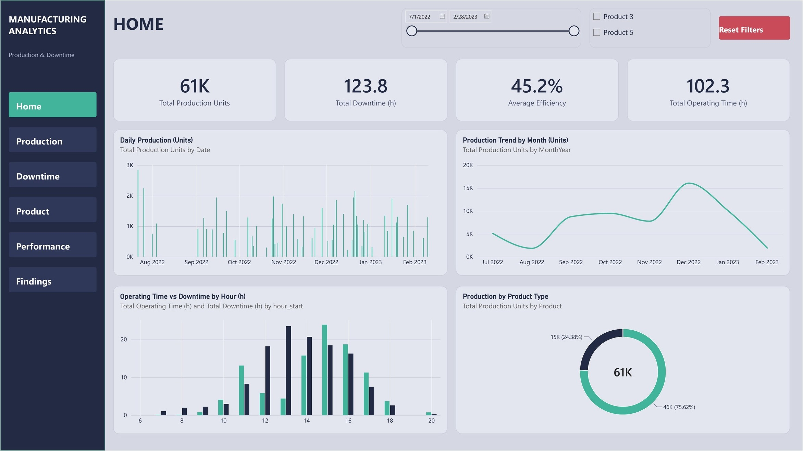
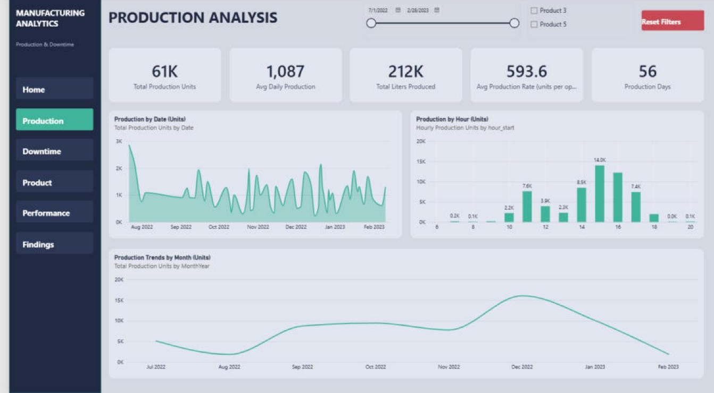
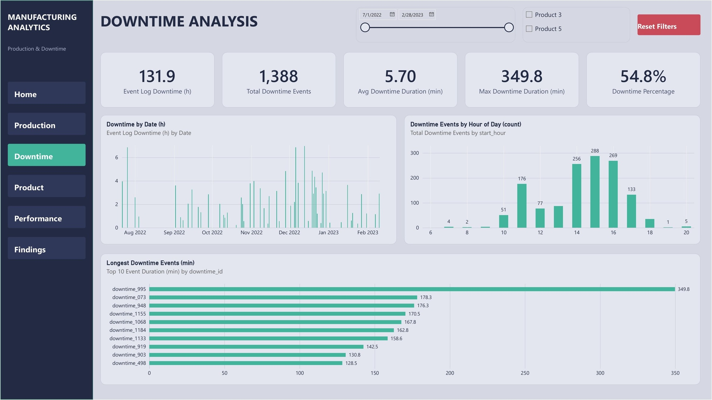
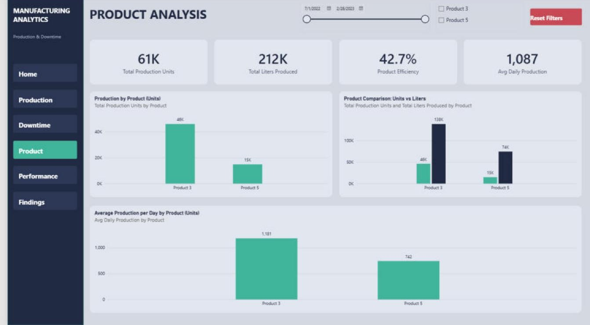
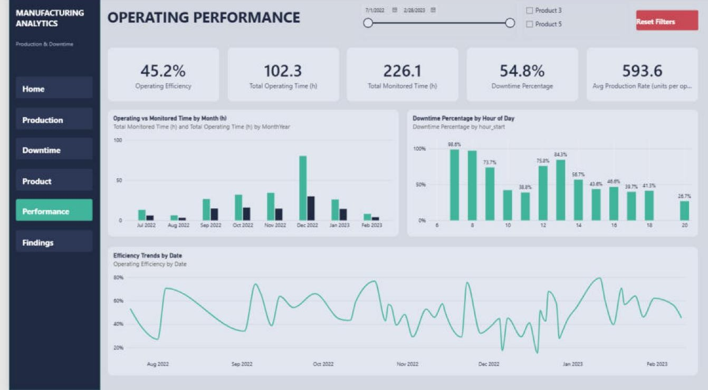
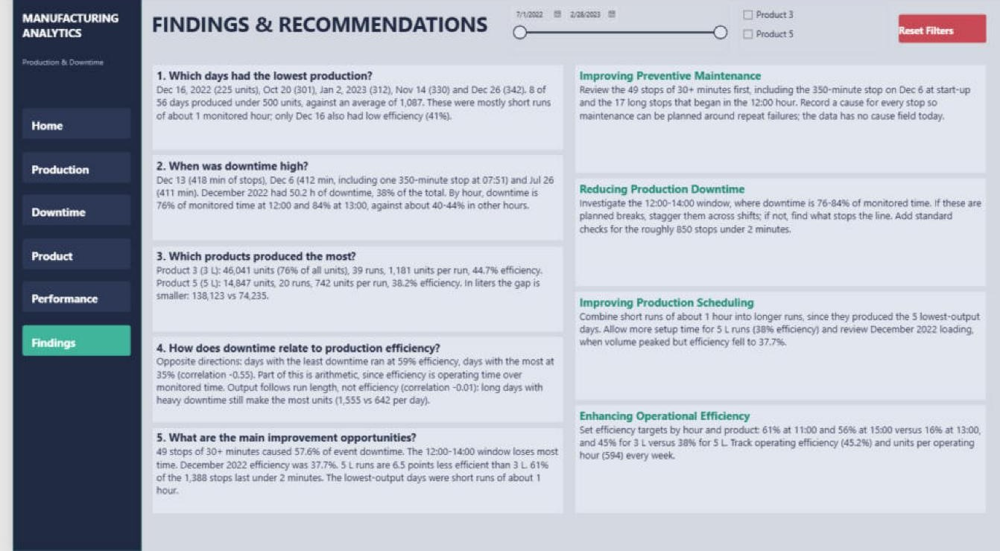

# Manufacturing Production & Downtime Analysis

**Project type:** Industrial Engineering | Data Analytics | Business Intelligence
**Tools:** Microsoft Excel, Power BI, Power Query, DAX

**Quick links:** [Portfolio page (live)](https://mohdaref12345-hash.github.io/manufacturing-production-downtime-analysis/portfolio.html) | [Power BI dashboard](Manufacturing_Production_Downtime_Analysis.pbix) | [Cleaned data](Manufacturing_Cleaned_Data.xlsx) | [Analytics report (PDF)](Manufacturing_Analytics_Report.pdf) | [DAX measures](DAX_Measures.txt)

## Dashboard preview



[Open full-size image: Home.jpg](Home.jpg)


## How to open the dashboard

- **Repository:** [https://github.com/mohdaref12345-hash/manufacturing-production-downtime-analysis](https://github.com/mohdaref12345-hash/manufacturing-production-downtime-analysis)
- **Power BI file (download and open in Power BI Desktop):** [Manufacturing_Production_Downtime_Analysis.pbix](https://github.com/mohdaref12345-hash/manufacturing-production-downtime-analysis/raw/main/Manufacturing_Production_Downtime_Analysis.pbix)
- **Portfolio page (opens as a normal web page):** [https://mohdaref12345-hash.github.io/manufacturing-production-downtime-analysis/portfolio.html](https://mohdaref12345-hash.github.io/manufacturing-production-downtime-analysis/portfolio.html)

Steps:
1. Click the `.pbix` link above (or the file in the repository, then Download raw file).
2. Open it with Power BI Desktop (free from Microsoft).
3. Use the sidebar buttons (Home, Production, Downtime, Product, Performance, Findings) to switch sections. In Desktop edit mode hold **Ctrl** while clicking a button, or use View > Bookmarks. In the Power BI service a normal click works.
4. Use the Date and Product slicers and the **Reset Filters** button on any section.

The dashboard is a Power BI file, so it has no public web link unless it is published to the Power BI service; the images below show every section.

## 1. Project objective

Analyze manufacturing production data to evaluate production performance, operational efficiency and downtime, then identify opportunities to improve manufacturing operations.

- Analyzed manufacturing production data to evaluate operational efficiency and production performance.
- Developed an interactive Power BI dashboard to monitor production KPIs and downtime.
- Performed data cleaning, data modeling and KPI calculations using Power Query and DAX.
- Identified operational trends and developed data-driven recommendations for manufacturing process improvement.

## 2. Data

Source: `Production raw.xlsx` (cleaned version: [Manufacturing_Cleaned_Data.xlsx](Manufacturing_Cleaned_Data.xlsx)) with four sheets: `processed_hourly`, `daily_operation_summary`, `hourly_operation_breakdown`, `downtime_event_log`.
Period: 1 Jul 2022 to 28 Feb 2023 (56 production days).

Data notes (documented, not hidden):
- The column named `production_gallons` holds production **units**; liters = units x pack size (3 or 5).
- Downtime events dated 2022-01-13 fall outside the data period and were corrected to 2023-01-13 (the original is kept in `date_original`).
- Downtime comes from two sources that differ slightly: hourly breakdown 123.8 h, event log 131.9 h. The dashboard labels which one each card uses.
- OEE is not calculated. "Efficiency" means operating time / monitored time.

## 3. Dashboard (one report page, six sections)

The dashboard file is [Manufacturing_Production_Downtime_Analysis.pbix](Manufacturing_Production_Downtime_Analysis.pbix); the measures are listed in [DAX_Measures.txt](DAX_Measures.txt). The sidebar buttons switch sections through bookmarks. In Power BI Desktop edit mode use **Ctrl+click** on a button (or View > Bookmarks); in the published service a normal click works. Date and Product slicers and a **Reset Filters** button are on every section.

### 3.1 Home


[Open full-size image: Home.jpg](Home.jpg)

Headline KPIs: total production, downtime, average efficiency and operating time, with daily and monthly production, hourly operating vs downtime, and product mix.

- 61K total production units
- 123.8 h total downtime
- 45.2% average efficiency
- 102.3 h total operating time

### 3.2 Production Analysis



[Open full-size image: Production.jpg](Production.jpg)

Production by date, by hour of day and by month, with units per day and units per operating hour.

- 1,087 average units per production day over 56 days
- 593.6 units per operating hour
- 212K liters produced
- Output peaks at 14:00-16:00; December 2022 is the highest month

### 3.3 Downtime Analysis



[Open full-size image: Downtime.jpg](Downtime.jpg)

Downtime hours by date, event counts by start hour, and the ten longest events.

- 1,388 downtime events, 5.70 min on average
- Longest event: 349.8 min (downtime_995)
- Event-log downtime 131.9 h
- Most events start between 14:00 and 16:00

### 3.4 Product Analysis



[Open full-size image: Product.jpg](Product.jpg)

Production by product, units vs liters, and average daily production per product.

- Product 3 (3 L): 46K units, 1,181 per run
- Product 5 (5 L): 15K units, 742 per run
- Product 3 is 76% of units, but in liters it is 138K vs 74K
- Product efficiency 42.7%

### 3.5 Operating Performance



[Open full-size image: Performance.jpg](Performance.jpg)

Operating vs monitored time by month, downtime percentage by hour, and the efficiency trend by date.

- 45.2% operating efficiency, 54.8% downtime
- 102.3 h operating of 226.1 h monitored
- Downtime share is highest at 07:00-08:00 and 12:00-13:00
- Efficiency swings between about 15% and 80% by day

### 3.6 Findings & Recommendations



[Open full-size image: Findings.jpg](Findings.jpg)

Answers to five analysis questions and four recommendations, all computed from the data.

- Lowest days: Dec 16, 2022 (225 units), Oct 20 (301), Jan 2 (312)
- 49 stops of 30+ min caused 57.6% of event downtime
- Downtime and efficiency: correlation -0.55
- Four recommendations: maintenance, downtime, scheduling, efficiency

## 4. Key findings

1. **Lowest production days:** Dec 16, 2022 (225 units), Oct 20 (301), Jan 2, 2023 (312), Nov 14 (330), Dec 26 (342). 8 of 56 days produced under 500 units (average 1,087), mostly short runs of about one monitored hour.
2. **High downtime:** Dec 13 (418 min), Dec 6 (412 min, including a 350-minute stop) and Jul 26 (411 min). December 2022 had 50.2 h of downtime, 38% of the total. Downtime is 76% of monitored time at 12:00 and 84% at 13:00.
3. **Products:** Product 3 produced 46,041 units (76%); Product 5 produced 14,847. In liters: 138,123 vs 74,235.
4. **Downtime vs efficiency:** opposite directions (correlation -0.55), partly arithmetic since efficiency is operating time over monitored time. Output follows run length, not efficiency (correlation -0.01).
5. **Improvement opportunities:** 49 stops of 30+ minutes caused 57.6% of event downtime; the 12:00-14:00 window loses the most time; December 2022 efficiency was 37.7%; 5 L runs are 6.5 points less efficient than 3 L.

## 5. Recommendations

- **Improving Preventive Maintenance:** review the 49 long stops first and record a cause for each stop (the data has no cause field today).
- **Reducing Production Downtime:** investigate the 12:00-14:00 window; stagger breaks across shifts if planned; add checks for the ~850 stops under 2 minutes.
- **Improving Production Scheduling:** combine short ~1 hour runs into longer runs; allow more setup time for 5 L runs; review December 2022 loading.
- **Enhancing Operational Efficiency:** set efficiency targets by hour and product and track operating efficiency and units per operating hour weekly.

## 6. Repository structure

```
manufacturing-production-downtime-analysis/
|-- README.md                                       <- this file
|-- portfolio.html                                  <- portfolio page (live on GitHub Pages; images embedded)
|-- Manufacturing_Production_Downtime_Analysis.pbix <- Power BI dashboard (6 sections)
|-- Manufacturing_Cleaned_Data.xlsx                 <- cleaned data + Data_Quality_Log + Reconciliation
|-- Manufacturing_Analytics_Report.pdf              <- written analytics report
|-- DAX_Measures.txt                                <- DAX measures
|-- Home.jpg
|-- Production.jpg
|-- Downtime.jpg
|-- Product.jpg
|-- Performance.jpg
`-- Findings.jpg
```

Each image is named after the sidebar button of the dashboard section it shows (Home, Production, Downtime, Product, Performance, Findings).
